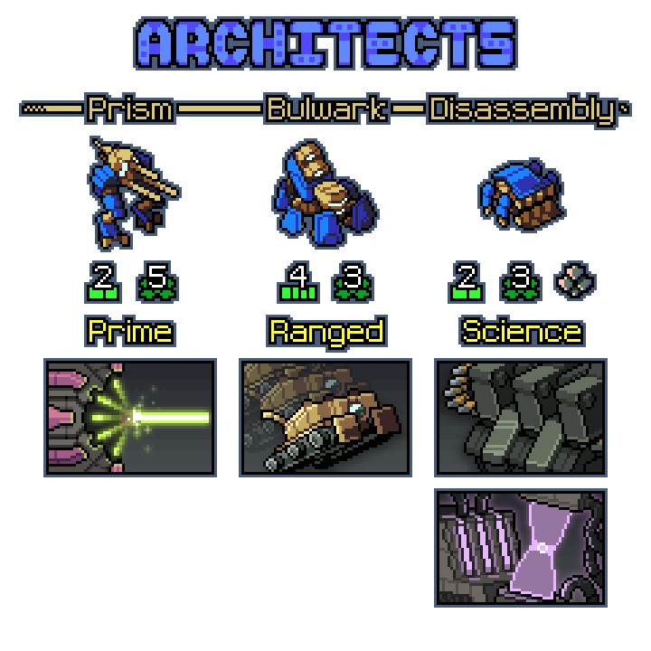
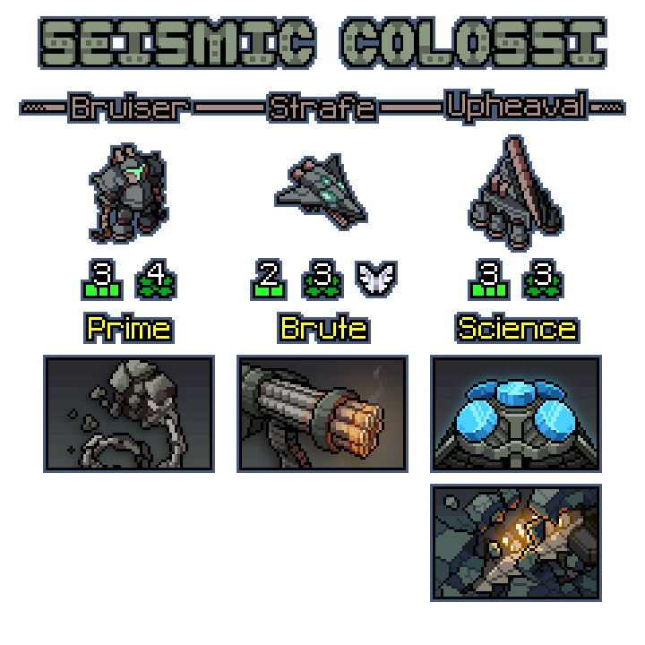
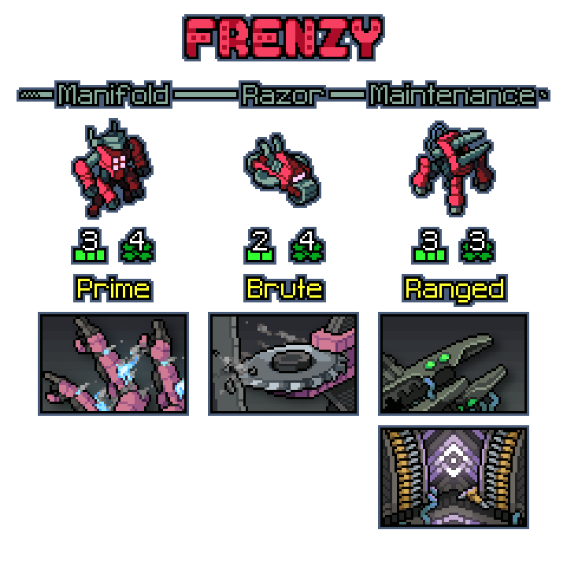
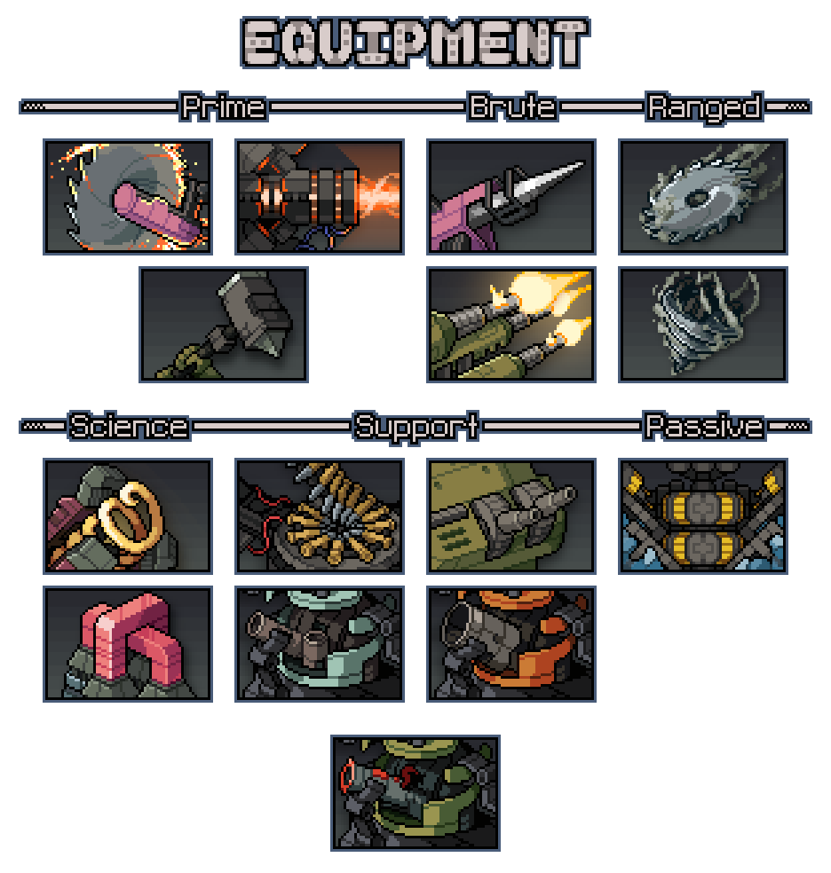
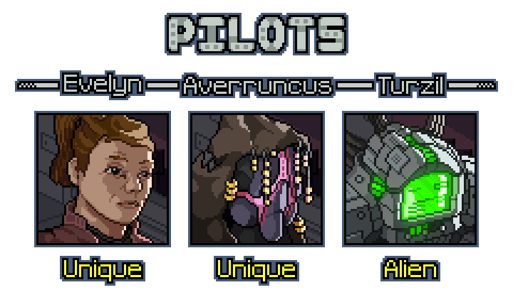
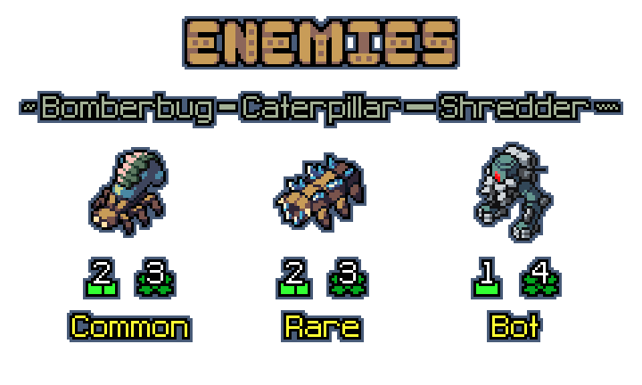

# Impact
A huge Content pack for Into the Breach, Impact adds a grand total of:
- 3 New Squads
- 11 New pieces of Squad Equipment
- 15 New pieces of Drop Equipment
- 3 New Pilots
- 3 New Enemies

Of course, this new content isn't just new formulas of the vanilla equipment - Impact implements the Supply status and Multihit weapons, adding a fresh new coat of paint to the game.
To play, download the newest release version from this repository.
  
  
*Do not download the code base itself. In addition to the file being several times larger due to repo assets, doing so risks encountering unfinished or unstable work.*

### Supply
An applicable status that can only be applied to Mechs, Supply grants/restores an additional use for all of the Mech's held limited-use weapons for the current mission, even allowing going above the uses you started the mission with.

### Multihit
Many weapons in Impact are multihit weapons, which hit the same tile(s) multiple times in a row or fire multiple projectiles in the same direction in sequence. This ranges across all four classes, and creates weapon with unparalleled concentrated effects.
 
 

## Squads
  
\
The deadly Architects show an unprecedented level of skill expression and complexity despite half of their weapons having zero displacement capabilities. Line Vek up to knock them down and consume the stragglers to fuel this squad's rapid ammunition consumption.
  
  
  
\
The brutal Seismic Colossi wield an arsenal of area denial tools, constructing vast walls across the battlefield of massive, durable rock formations that serve a double purpose - imprisoning targets and preventing harm to civilians from the Colossi's own overwhelming firepower.
  
  
  
\
The maniacal Frenzy throw caution to the wind, succumbing to grievous damage and rising from the grave multiple times each battle. However, not only is lacking self-preservation useful, it is a base requirement in order sustain the uses of their powerful limited-use weapon.
 
 

## Equipment
  
\
Even more so than in squads, Impact integrates Multihit and Supply through a wide array of drop equipment, much of which is limited-use, that can be found during runs - including such oddities as a massive cannonade of projectiles, a hammer capable of instantly crushing targets, a contraption that manipulates gravity to generate opposite forces anywhere on the board, a saw fired as an artillery that fractures into deadly shards, an ammunition belt that can be used to restore a Mech's own uses, and even a passive powered by ice capable of fabricating munitions.
 
 

## Pilots
  
\
Impact introduces several pilots. Evelyn Moore maintains a calm, strategic mind to enable careful, sustainable use of limited weapons. Averruncus calls on barely-documented forces associated with The Breach, casting insanity over the minds of the Vek. Turzil, an Engi, makes an appearance from FTL, repairing with incredible efficacy and leaving Mechs ready to tackle future turns with ease. 
 
 

## Enemies
  
\
The enemies of Impact leverage multihit attacks to dish out incredible damage at the cost their own fragility. Bomberbugs make regular appearances, firing multiple pushing and damaging projectiles in sequence, resulting in an attack that's very difficult to block. Caterpillars Freeze their target and prepare to attack multiple times, damaging even through their own ice by shattering it with the first attack. Shredder-Bots appear on pinnacle, fast-moving melee bots that can tear straight through would-be protective Shields or ice.
 
 

## Other Features
Impact also offers a small set of dialog events and balance changes to spice up the game.
  
Added dialog not only highlights the nuances of limited uses and Supply, but retroactively adds events for previously silent occurrences in vanilla such as a Mech being Boosted.
  
The small set of balance changes are mostly aimed at retroactively implementing Impact features into a couple of Vanilla pieces of Equipment.
 
 

### Have Some Feedback?
Say hello on the Into The Breach Discord:  
*[Into The Breach Discord](https://discord.gg/ae3DHnBDA)*  
My Development / Feedback Thread:  
*[#modding-witheredplate](https://discord.com/channels/417639520507527189/1526695886770540674)*  
